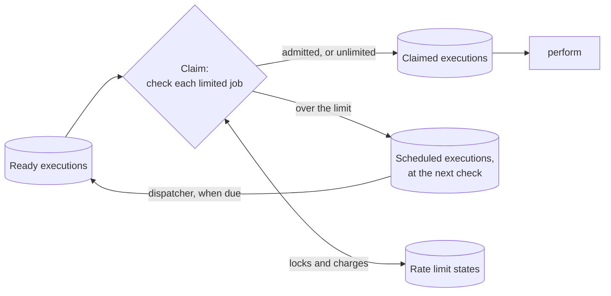
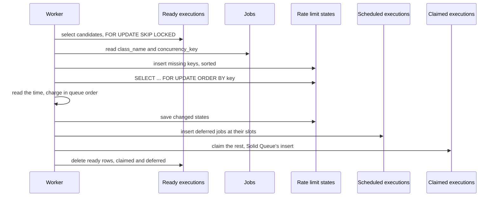

# Design

This document explains how the gem works, for contributors and for anyone reviewing it against Solid Queue. You don't need to read the code to follow it, and [Where it lives](#where-it-lives) maps each idea to its file. The [README](../README.md) describes the behaviour applications can rely on. Everything here can change between versions.

## The gem in one picture

A worker's claim locks a batch of ready executions. Before Solid Queue turns them into claimed executions, the gem checks each limited job against its class's budget. Jobs over the limit become scheduled executions instead, and the dispatcher brings them back when their next check is due.



Nothing happens at enqueue apart from a check that the table exists, and nothing happens when a job runs. The whole limit lives in one step of the claim.

## Terms

| Term | Meaning |
| --- | --- |
| Claim | A worker taking ready executions and turning them into claimed ones, in one transaction per pass |
| Pass | One run of Solid Queue's `select_and_lock`: select and lock candidates, then claim them |
| Candidate | A ready execution that a pass has locked with `SKIP LOCKED` |
| `T` | The interval between admissions, `per / to` |
| `τ` | The slack a burst gives, `(burst - 1) × T` |
| TAT | GCRA's theoretical arrival time, stored per limit. The budget is full when it's in the past |
| Slot | A next-check time handed to a waiting job. A hint, never a charge |
| Dispatcher | The Solid Queue process that makes scheduled executions ready when they're due |

## The claim seam

The gem prepends two private class methods of `SolidQueue::ReadyExecution`:

- `lock_candidates(executions, process_id)` gets the candidates once `select_candidates` has locked them, inside the pass's transaction. The gem splits off the jobs over their limit, schedules them, deletes their ready rows and passes the rest to Solid Queue.
- `select_and_lock(queue_relation, process_id, limit)` runs a pass. The gem runs more passes when one deferred jobs. See [Refill](#refill).

`lock_candidates` is the one place where the candidates are known and locked, and nothing has been claimed yet. Admission there is atomic with the claim, so a rolled-back claim rolls back its charges too. The seam is byte-identical from Solid Queue 1.7.0 to 1.7.2, and the gemspec pins `~> 1.7.0` because each minor has to be checked again. [#9](https://github.com/dtcristo/solid_queue-rate_limit/issues/9) is about proposing a public hook upstream.

The patches are applied from the engine's `to_prepare`, because Solid Queue's models are reloadable.

## Settings

The limit comes from the job's class, found through `solid_queue_jobs.class_name`, in the worker that claims it. There's no table of assignments and nothing is worked out at enqueue. Arguments are never deserialized during a claim.

This keeps enqueues free and lets a deploy change a limit for jobs already waiting. The cost is that a worker has to load the class to know its limit. See [Class load failures](#class-load-failures). Workers with different settings for one class, during a rolling deploy, share the class's state and each apply their own.

The state's key is the class's name, read from the loaded class, not from the job row. A job enqueued under an alias constant shares its class's budget.

## Table

```ruby
create_table :solid_queue_rate_limits do |t|
  t.string :key, null: false             # the job class's name in 0.1.0
  t.datetime :tat, null: false           # GCRA theoretical arrival time
  t.datetime :deferred_until             # the latest slot handed out, a hint
  t.timestamps
  t.index :key, unique: true
end
```

One row per limited class, made the first time a claim needs it. There are no foreign keys, and Solid Queue's tables don't change. `key` uses the database's default collation, like Solid Queue's semaphores. Under MySQL's case-insensitive default, two class names that differ only in case find the same row and share a budget. `lock_all` maps each key to the row it matched, so it doesn't fail on the spelling difference.

## A claim pass



The candidates come in Solid Queue's queue order, and the gem charges them in that order. A job is limited when its class loads, is an `ActiveJob::Base` subclass, declares `limits_rate`, and the job has no concurrency key.

The time is read once the state rows are locked. Two claims that share a limit run one after the other, and the second sees the first's admissions and a later time.

## Lock order

Every pass takes its locks in the same order:


Ready rows never wait, because `SKIP LOCKED` passes over a row another claim holds. State rows are the only ones claims wait for, and they're always taken in key order, so two claims that share several limits can't wait on each other in a cycle. With Solid Queue's `use_skip_locked` off, claims wait for ready rows too, but a claim that holds a state row never asks for a ready row after it, so that still can't form a cycle.

`lock_all` reads which keys exist before it inserts the missing ones. On PostgreSQL, an insert that skips a duplicate still takes a value from the id sequence, and reading first keeps that off the hot path. MySQL doesn't support `insert_all` with `unique_by`, so the insert relies on the unique index to skip a key that another claim inserted in the meantime.

On SQLite there are no row locks. A claim is a write transaction, and claims take turns on the database lock. Rails 8 opens IMMEDIATE transactions, so a claim takes the write lock up front instead of upgrading from a reader. The concurrency test checks that claims still get through while another connection upgrades a deferred transaction.

## GCRA

With `T = per / to` and `τ = (burst - 1) × T`:

1. Clamp: `tat = min(tat, now + burst × T)`.
2. Admit when `tat <= now + τ`, and then set `tat = max(tat, now) + T`.
3. Round `tat` up to the microsecond.

From a full budget that admits `burst` jobs at once, then one every `T`. In any window of length `w`, it admits at most `burst + floor(w / T)`.

Here's why. Say the first admission in the window is at `t1`. After `i` admissions, `tat` is at least `t1 + i × T`. The next admission at time `t` needs `tat <= t + τ`. So it can't come before `t1 + (i - burst + 1) × T`.

The clamp never changes anything under a constant limit, because an admission leaves `tat` at most `now + burst × T`. It only matters after a deploy loosens the limit. Without it, debt built up under the old limit would hold the new one back, and with a much smaller `T` that could last minutes. With it, the debt left is at most `burst` new intervals, rounded up to the microsecond, so the next admission is at most one new interval and a microsecond away. Slots handed out under the old limit stay, and new slots go after them, so waiting jobs can take up to 5 minutes to catch up.

Rounding down would drop a little debt on every admission, and datetime columns store microseconds. So `tat` rounds up, and a limit can only err on the slow side. `T` has to be at least 1 ms, so rounding never takes a large share of it.

`T` is a `Rational`, so `to: 3, per: 1.second` carries no floating-point error. Rounding still adds up to 1 µs per admission, always on the slow side. Three admissions at `T = 1/3` second leave `tat` at 1.000002 seconds.

## Deferral and staggering

A job the budget rejects gets the next free slot:

```text
slot = max(tat - τ, deferred_until + T)
```

`tat - τ` is when the budget next admits one, and `deferred_until + T` is one interval after the last slot handed out. If the slot is within 5 minutes, the job takes it and `deferred_until` moves to it. Otherwise the job checks again in 5 minutes, and `deferred_until` stays.

The job's scheduled execution gets the slot as its `scheduled_at`. `solid_queue_jobs.scheduled_at` stays as it was, so a job enqueued with `wait:` keeps its own time.

Slots never touch `tat`. A job that comes back at its slot is charged like any other, and if the budget is spent by then, it gets a new slot after the others. A fresh job that arrives when the budget has room is admitted even if slots are outstanding, so waiting jobs can be overtaken.

Without staggering, every rejected job would come back on the next dispatcher poll and get rejected again. A spike before 0.1.0, with 100 jobs at 30 per minute, made 3,350 deferrals and held up unrelated jobs on the same queue for 101 seconds. With staggering it made 99 deferrals and held them up for 5 seconds, and 2 seconds with refill.

The 5-minute cap is there because slots are promises nobody keeps track of. If waiting jobs get discarded, or a deploy loosens the limit, their slots go unused, and the cap bounds how long that can strand capacity. The cost is churn on a backlog longer than 5 minutes, where jobs past the cap come back every 5 minutes to be deferred again. See [Open doubts](#open-doubts).

## Refill

A pass that defers jobs leaves threads idle that could run jobs behind them in the queue. So `select_and_lock` runs another pass for the remaining capacity, up to 5 passes per poll, while the last pass deferred something and capacity remains. Each pass is a transaction of its own, so a later pass's failure can't undo an earlier one's claims.

`lock_candidates` tells `select_and_lock` whether its pass deferred anything through a thread-local flag, because Solid Queue's `select_and_lock` returns only the claimed executions.

Inside an outer transaction, the gem runs a single pass, with admission but without refill. A pass can't commit on its own there, so holding state locks across several passes would only make the outer transaction longer. A deadlock aborts the whole outer transaction, so there would be no earlier pass to keep either.

## Deadlocks

The lock order rules out cycles on the state rows. InnoDB can still deadlock through gap locks, for example when two claims insert neighbouring missing keys.

Each refill pass rescues `ActiveRecord::Deadlocked`. A deadlock on the first pass raises, as it would without the gem, and the pass rolls back. A deadlock on a later pass rolls back only that pass, and the claim returns what earlier passes committed.

## Fast path

`RateLimit.declared` turns on when any class declares `limits_rate`. When the app is eager-loaded and nothing has declared one, both patched methods call Solid Queue straight away, and a claim runs exactly Solid Queue's queries. A test checks the query list.

Without eager loading, a class may not load until its job is claimed, so the gem can't know that nothing is limited. Then, or once any class declares a limit, it checks every batch, which costs one read of the candidates' jobs per pass. Once a batch has limited jobs, it also locks one state row per limited class, and writes the states that changed.

## Missing migration

`SolidQueue::Job.enqueue` and `enqueue_all` raise `RateLimitState::PendingMigrations` for a limited class while the table is missing. They're prepended on the model rather than the adapter, because `RecurringTask` calls `Job.enqueue` directly. It's best effort. A gem that enqueues through its own path, such as solid_queue-coalesce's coalesced enqueues, can skip it.

A claim fails closed. Limited jobs that reach a worker without the table get scheduled a minute out, without any state, and each process logs one error. `migrated?` remembers only a true answer, but Active Record's schema cache remembers a missing table too, so a process has to restart to see the table.

## Class load failures

A class that raises `StandardError` or `ScriptError` when its name is constantized counts as unlimited, as does a constant that isn't an `ActiveJob::Base` subclass. Its job is claimed, and `execute` fails it the way Solid Queue would without the gem. One broken class can't stop a claim, and so can't stop unrelated jobs in the same batch.

## Concurrency keys

`limits_rate` and `limits_concurrency` on one class raise, in either order and through inheritance. The gem overrides `limits_concurrency(**)` to check, as solid_queue-coalesce does. [#2](https://github.com/dtcristo/solid_queue-rate_limit/issues/2) is about combining them.

A ready job can still have a concurrency key if its class switched from `limits_concurrency` to `limits_rate` while it waited. That job holds its semaphore, so deferring it would keep the semaphore taken while it waits and block the jobs behind it. It's admitted without a check, and without a charge.

## Re-claims

A job that comes back to ready is charged again. That covers a `retry_on` retry, which enqueues a new job, a failed job you retry, and a claim released when a worker shuts down. The gem doesn't record which jobs it admitted. That's what makes the guarantee one about claims, not jobs, and it costs nothing to keep.

## Throughput with a small burst

Waiting jobs come back through the dispatcher, and a worker claims them a little after each dispatcher poll. With `burst: 1`, `τ` is 0. Admitting a job sets `tat` to its claim time plus `T`, but the next waiting job's slot was set one `T` after the previous slot. It arrives at its slot plus its own delay, so it's admitted only if its delay is at least the previous job's. Otherwise it gets the slot after all the others, and the slot it missed goes unused.

Delays come from the dispatcher's poll and the worker's poll, and they vary by up to the worker's polling interval. Lowering the dispatcher's `polling_interval` doesn't help, because the delays still vary. Against a real supervisor on SQLite, with one worker polling every 0.1 seconds, `to: 1, per: 1.second` drained a backlog at 0.55 jobs per second with a 1-second dispatcher poll, and at 0.53 with a 0.1-second one. `burst: 2` drained it at 0.95 and 1.0.

A dispatcher poll also makes about `to × polling_interval / per` jobs due at once, and one claim takes them together, so the budget has to admit that many at once. The slack on top has to cover the variation in claim delays, up to the worker's polling interval, which is `to × worker polling_interval / per` intervals. That's the rule of thumb in the README: `burst >= to × (dispatcher polling_interval + worker polling_interval) / per`, rounded up, and at least 2. The recipe test replays it with fixed delays in simulated time. It isn't a bound, because a slow claim can vary its delay by more than a polling interval.

## Alternatives considered

- **Blocking like `limits_concurrency`.** Solid Queue moves a blocked job to `solid_queue_blocked_executions` and unblocks it when a semaphore is released. A rate limit frees capacity as time passes, not when a job finishes, so nothing would unblock the job without a new poller. Scheduled executions already have one, the dispatcher.
- **A table and a poller of our own.** A `rate_limited_executions` table would keep waiting jobs out of the scheduled list, but needs a process to run and its own failure handling. It's out of scope until there's a need, per [#10](https://github.com/dtcristo/solid_queue-rate_limit/issues/10).
- **Checking at dispatch.** The dispatcher doesn't know which worker will claim a job or when, and a job enqueued as ready never passes through it. A dispatch-time check can't bound claims. [#5](https://github.com/dtcristo/solid_queue-rate_limit/issues/5) looks at it as a precheck on top.
- **Slots worked out at enqueue.** Setting `scheduled_at` when a job is enqueued would reserve future capacity. A cancelled job or a loosened limit would strand it, and retries would need their own slots. Waiting at claim keeps reservations as hints that can't strand anything for more than 5 minutes.
- **Recording each job's limit at enqueue.** An assignments table would let a worker skip loading the class. It costs a write per enqueue, and a loosened limit wouldn't reach jobs already waiting.
- **Sleeping in `perform`, or `retry_on` after a 429.** Both tie up worker threads or create retries, and neither holds across workers. This is what the gem replaces.
- **Exact sliding windows or token buckets.** An exact window needs a row per admission. GCRA needs one timestamp per limit, and its error bound, `burst + floor(w / T)`, is easy to state.
- **Deferring without staggering, or without a cap.** Without staggering, a backlog bounces between scheduled and ready on every poll. See [Deferral and staggering](#deferral-and-staggering). Without a cap, discarded jobs or a loosened limit could strand capacity for as long as the backlog.

## Open doubts

- Capped staggering on a large, slow backlog isn't stress-tested. With 10,000 jobs at 1 per minute, 5 jobs hold slots and the rest come back every 5 minutes, about 33 dispatches and deferrals a second for nothing.
- On Rails 7.x, SQLite transactions are DEFERRED, so a claim starts as a reader and upgrades to a writer. The dummy app opens IMMEDIATE transactions on every Rails version, so the suite has never run claims on Rails 7.x's default.
- On MySQL, a claim's scheduled inserts and the dispatcher's ready inserts could take gap locks that deadlock each other. Testing hasn't shown it. A deadlock on a claim's first pass raises as it would without the gem.
- With `burst: 1`, a backlog drains at about half to nine tenths of the rate. See [Throughput with a small burst](#throughput-with-a-small-burst). [#6](https://github.com/dtcristo/solid_queue-rate_limit/issues/6) is the place to change that.

## Where it lives

| Idea | File | Names |
| --- | --- | --- |
| Declaring `limits_rate` | `lib/active_job/rate_controls.rb` | `limits_rate`, `rate_limited?`, `rate_limit_interval`, `limits_concurrency` |
| Admission, deferral and scheduling | `app/models/solid_queue/ready_execution/rate_limited.rb` | `defer_rate_limited`, `check_rate_limits`, `schedule_rate_limited`, `rate_limited_job_class` |
| GCRA and slots | `app/models/solid_queue/rate_limit_state.rb` | `lock_all`, `admit`, `defer`, `MAX_DEFERRAL`, `PendingMigrations` |
| Every place the gem reaches into Solid Queue | `lib/solid_queue/rate_limit/patches.rb` | `Claiming`, `Enqueuing`, `MAX_CLAIM_PASSES`, the log subscriber |
| The fast path | `lib/solid_queue/rate_limit.rb` | `declared`, `enforced?` |
| Table | `lib/generators/solid_queue/rate_limit/install/templates/db/create_solid_queue_rate_limits.rb` | |
