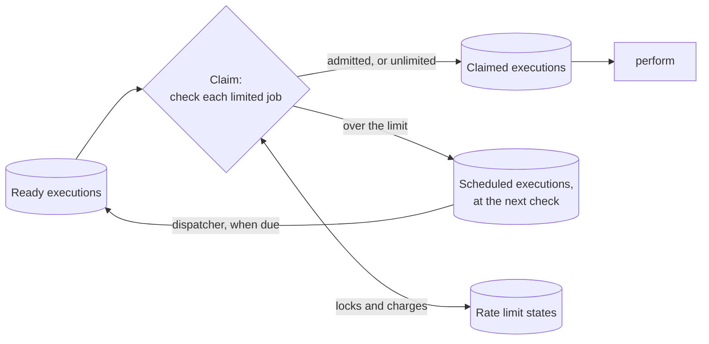
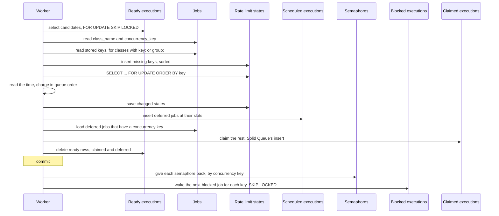

# Design

This document explains how the gem works, for contributors and for anyone reviewing it against Solid Queue. You don't need to read the code to follow it, and [Where it lives](#where-it-lives) maps each idea to its file. The [README](../README.md) describes the behaviour applications can rely on. Everything here can change between versions.

## The gem in one picture

A worker's claim locks a batch of ready executions. Before Solid Queue turns them into claimed executions, the gem checks each limited job against its budget. Jobs over the limit become scheduled executions instead, and the dispatcher brings them back when their next check is due.



At enqueue the gem only checks that the table exists, and works out the key of a job whose class declares `key:` or `group:`. Nothing happens when a job runs. The whole limit lives in one step of the claim.

## Terms

| Term | Meaning |
| --- | --- |
| Claim | A worker taking ready executions and turning them into claimed ones, in one transaction per pass |
| Pass | One run of Solid Queue's `select_and_lock`: select and lock candidates, then claim them |
| Candidate | A ready execution that a pass has locked with `SKIP LOCKED` |
| Budget | One GCRA state, shared by every job with the same key |
| Key | The name of a budget's state row. The class's name, unless the class declares `key:` or `group:` |
| Group | What `group:` names, so several classes share their budgets. Defaults to the class's name |
| `T` | The interval between admissions, `per / to` |
| `τ` | The slack a burst gives, `(burst - 1) × T` |
| TAT | GCRA's theoretical arrival time, stored per limit. The budget is full when it's in the past |
| Slot | A next-check time handed to a waiting job. A hint, never a charge |
| Dispatcher | The Solid Queue process that makes scheduled executions ready when they're due |

## The claim seam

The gem prepends two private class methods of `SolidQueue::ReadyExecution`:

- `lock_candidates(executions, process_id)` gets the candidates once `select_candidates` has locked them, inside the pass's transaction. The gem splits off the jobs over their limit, schedules them, deletes their ready rows and passes the rest to Solid Queue.
- `select_and_lock(queue_relation, process_id, limit)` runs a pass. The gem runs more passes when one deferred jobs. See [Refill](#refill).

`lock_candidates` is the one place where the candidates are known and locked, and nothing has been claimed yet. Admission there is atomic with the claim, so a rolled-back claim rolls back its charges too. The seam is byte-identical from Solid Queue 1.7.0 to 1.7.2. The gemspec requires `>= 1.7.2, < 1.8`, because each minor has to be checked again, and because 1.7.2 records which semaphore a job holds. See [Concurrency keys](#concurrency-keys). [#9](https://github.com/dtcristo/solid_queue-rate_limit/issues/9) is about proposing a public hook upstream.

The patches are applied from the engine's `to_prepare`, because Solid Queue's models are reloadable.

## Settings

The limit comes from the job's class, found through `solid_queue_jobs.class_name`, in the worker that claims it. There's no table of assignments. Arguments are never deserialized during a claim.

This keeps enqueues cheap and lets a deploy change a limit for jobs already waiting. The cost is that a worker has to load the class to know its limit. See [Class load failures](#class-load-failures). Workers with different settings for one class, during a rolling deploy, share the class's state and each apply their own.

Without `key:` or `group:`, the state's key is the class's name, read from the loaded class, not from the job row. A job enqueued under an alias constant shares its class's budget.

## Keys and groups

`key:` and `group:` take what `limits_concurrency` takes, and the key is built the way Solid Queue's `concurrency_key` is: `[group, param].compact.join("/")`. The group defaults to the class's name, and a record param becomes its class name and id. Both go through Solid Queue's own `compute_concurrency_parameter`, so a String or Symbol is used as it is, a Proc runs with the job's arguments, and anything else is `nil`. A key that comes out blank isn't stored, so the job uses its class's budget.

The key is computed in `serialize`, only for a class that declares `key:` or `group:` and only when the class's adapter is Solid Queue, the check solid_queue-coalesce uses. Solid Queue calls `serialize` inside `Job.enqueue`, so a Proc that raises fails the enqueue, and `perform_now` and other adapters never run it. The key goes into the job's serialized data as `"solid_queue_rate_limit_key"`, named like Solid Queue's `"solid_queue_concurrency_lock"`. `deserialize` reads it back, and `serialize` keeps a key it already has, so a `retry_on` retry, including one after the arguments failed to deserialize, keeps the key without running the Proc again. A failed job you retry keeps its row, and with it its key.

The state table's `key` column limits how long a key can be. On MySQL that's 255 characters, and `serialize` raises `ActiveRecord::ValueTooLong` for a longer key, so it can't fail claims later. Solid Queue wraps it in `EnqueueError` for `perform_later` and lets it through for `perform_all_later`, as it does for an over-long `concurrency_key`. PostgreSQL and SQLite report no limit.

At claim, after the classes have loaded, the gem reads `arguments` only for limited jobs whose class declares `key:` or `group:`, in one query per pass, and takes the stored key. Claims of other jobs run the same queries as in 0.1.0, and a test checks the list. A job with no stored key, such as one enqueued before its class declared `key:`, uses its class's name. So does a job whose class stopped declaring them. A class that's no longer limited isn't limited, whatever its jobs stored.

Each job is charged with its own class's settings, against the state of its key. Classes in a group are meant to declare the same settings, but the gem doesn't check, as Solid Queue doesn't for concurrency groups. Mixed settings can admit more than the stricter one allows.

Keys aren't tagged or escaped, like concurrency keys, so a group named after a job class shares that class's budget, and `/` inside a value can make two keys collide. The README documents this instead of preventing it.

Reading the key from `arguments` parses the whole JSON payload, which costs more for large payloads. Only keyed jobs pay it. See [Alternatives considered](#alternatives-considered).

## Table

```ruby
create_table :solid_queue_rate_limits do |t|
  t.string :key, null: false             # the class's name, or the key built from group: and key:
  t.datetime :tat, null: false           # GCRA theoretical arrival time
  t.datetime :deferred_until             # the latest slot handed out, a hint
  t.timestamps
  t.index :key, unique: true
end
```

One row per budget, made the first time a claim needs it, and deleted by `clear_idle_in_batches` once it's idle. See [Clearing idle budgets](#clearing-idle-budgets). There are no foreign keys, and Solid Queue's tables don't change. `key` uses the database's default collation, like Solid Queue's semaphores. Under MySQL's case-insensitive default, two keys that differ only in case find the same row and share a budget. `lock_all` maps each key to the row it matched, so it doesn't fail on the spelling difference.

## A claim pass



The candidates come in Solid Queue's queue order, and the gem charges them in that order. A job is limited when its class loads, is an `ActiveJob::Base` subclass, and declares `limits_rate`. A concurrency key doesn't change that. See [Concurrency keys](#concurrency-keys).

The time is read once the state rows are locked. Two claims that share a key run one after the other, and the second sees the first's admissions and a later time. Each key's row has its own `deferred_until`, so a backlog on one key doesn't push back the slots of another.

## Lock order

Every pass takes its locks in the same order:


The semaphores of deferred jobs are given back after the pass commits, so a claim never holds a semaphore. See [Concurrency keys](#concurrency-keys).

Ready rows never wait, because `SKIP LOCKED` passes over a row another claim holds. State rows are taken only by claims and the cleanup, always in key order, so two claims that share several limits can't wait on each other in a cycle. With Solid Queue's `use_skip_locked` off, claims wait for ready rows too, but a claim that holds a state row never asks for a ready row after it, so that still can't form a cycle.

Semaphores are where a claim meets the rest of Solid Queue. Each entry point that touches them takes its locks in this order:

| Entry point | Order | Who retries a deadlock |
| --- | --- | --- |
| Claim | Ready rows, `SKIP LOCKED`. Jobs, read. State rows, in key order. Scheduled inserts, claimed inserts and ready deletes. Then, after the commit, for each deferred job with a concurrency key, by `[concurrency_key, id]`: its semaphore, and blocked maintenance for its key, as after a job finishes | The first pass runs once more. A later pass rolls back and the claim returns what earlier passes committed. See [Deadlocks](#deadlocks) |
| Enqueue | Job inserts. Then ready inserts for jobs without a concurrency key, and for each job with one, by `[concurrency_key, id]`: its semaphore, its `arguments`, and its ready or blocked insert | Nobody. The enqueue raises, as in Solid Queue |
| Scheduled dispatch | Scheduled rows, `SKIP LOCKED`. Then as an enqueue, and last the scheduled deletes | `dispatch_next_batch` runs the batch once more |
| Blocked maintenance | For each key, in a transaction of its own: the next blocked row with `SKIP LOCKED`, its semaphore, its `arguments`, its ready insert and its blocked delete | Nobody. Solid Queue's maintenance logs the error and runs again at its next interval |
| Job finish | The claimed row and the job, in one transaction. Then, outside it, the job's semaphore, and blocked maintenance for its key | Nobody, as in Solid Queue |
| Discard | Ready rows, locked in `job_id` order without `SKIP LOCKED`. Then for each job, by id: its semaphore and blocked maintenance for its key. Last, job and ready deletes | Nobody. The discard raises, as in Solid Queue |

A claim gives semaphores back only after it commits, holding nothing else, by `[concurrency_key, id]` as a dispatch takes them, so it can't wait on another claim or a dispatch in a cycle through semaphores. Discard goes by job id, as in Solid Queue, so it can deadlock with a claim or a dispatch that holds several keys, as it already can with a dispatch.

Releasing inside the claim was tried first, and deadlocked on MySQL under load. A claim holding a state row woke a blocked job, inserting a ready row next to ready rows another claim had locked, and that claim was waiting for the state row. A claim that updated a semaphore while holding ready rows could also deadlock with anything that takes a semaphore and then inserts a ready row: the dispatcher, a job finishing, or maintenance. Solid Queue's own claims never touch semaphores, and the gem's claim transaction doesn't either. The release and the wake run after it commits.

`lock_all` reads which keys exist before it inserts the missing ones. On PostgreSQL, an insert that skips a duplicate still takes a value from the id sequence, and reading first keeps that off the hot path. MySQL doesn't support `insert_all` with `unique_by`, so the insert relies on the unique index to skip a key that another claim inserted in the meantime.

On SQLite there are no row locks. A claim is a write transaction, and claims take turns on the database lock. Rails 8 opens IMMEDIATE transactions, so a claim takes the write lock up front instead of upgrading from a reader. The concurrency test checks that claims still get through while another connection upgrades a deferred transaction.

## GCRA

With `T = per / to` and `τ = (burst - 1) × T`:

1. Clamp: `tat = min(tat, now + burst × T)`.
2. Admit when `tat <= now + τ`, and then set `tat = max(tat, now) + T`.
3. Round `tat` up to the microsecond.

From a full budget that admits `burst` jobs at once, then one every `T`. In any window of length `w`, it admits at most `burst + floor(w / T)`.

Here's why. Say the first admission in the window is at `t1`. After `i` admissions, `tat` is at least `t1 + i × T`. The next admission at time `t` needs `tat <= t + τ`. So it can't come before `t1 + (i - burst + 1) × T`.

The clamp never changes anything under a constant limit, because an admission leaves `tat` at most `now + burst × T`. It only matters after a deploy loosens the limit. Without it, debt built up under the old limit would hold the new one back, and with a much smaller `T` that could last minutes. With it, the debt left is at most `burst` new intervals, rounded up to the microsecond, so the next admission is at most one new interval and a microsecond away. Slots handed out under the old limit stay, and new slots go after them, so waiting jobs can take up to 5 minutes to catch up.

Rounding down would drop a little debt on every admission, and datetime columns store microseconds. So `tat` rounds up, and a limit can only err on the slow side. `T` has to be at least 1 ms, so rounding never takes a large share of it.

`T` is a `Rational`, so `to: 3, per: 1.second` carries no floating-point error. Rounding still adds up to 1 µs per admission, always on the slow side. Three admissions at `T = 1/3` second leave `tat` at 1.000002 seconds.

## Deferral and staggering

A job the budget rejects gets the next free slot:

```text
slot = max(tat - τ, deferred_until + T)
```

`tat - τ` is when the budget next admits one, and `deferred_until + T` is one interval after the last slot handed out. If the slot is within 5 minutes, the job takes it and `deferred_until` moves to it. Otherwise the job checks again in 5 minutes, and `deferred_until` stays.

The job's scheduled execution gets the slot as its `scheduled_at`. `solid_queue_jobs.scheduled_at` stays as it was, so a job enqueued with `wait:` keeps its own time.

Slots never touch `tat`. A job that comes back at its slot is charged like any other, and if the budget is spent by then, it gets a new slot after the others. A fresh job that arrives when the budget has room is admitted even if slots are outstanding, so waiting jobs can be overtaken.

Without staggering, every rejected job would come back on the next dispatcher poll and get rejected again. A spike before 0.1.0, with 100 jobs at 30 per minute, made 3,350 deferrals and held up unrelated jobs on the same queue for 101 seconds. With staggering it made 99 deferrals and held them up for 5 seconds, and 2 seconds with refill.

The 5-minute cap is there because slots are promises nobody keeps track of. If waiting jobs get discarded, or a deploy loosens the limit, their slots go unused, and the cap bounds how long that can strand capacity. The cost is churn on a backlog longer than 5 minutes, where jobs past the cap come back every 5 minutes to be deferred again. See [Open doubts](#open-doubts).

## Refill

A pass that defers jobs leaves threads idle that could run jobs behind them in the queue. So `select_and_lock` runs another pass for the remaining capacity, up to 5 passes per poll, while the last pass deferred something and capacity remains. Each pass is a transaction of its own, so a later pass's failure can't undo an earlier one's claims.

`lock_candidates` tells `select_and_lock` whether its pass deferred anything through a thread-local flag, because Solid Queue's `select_and_lock` returns only the claimed executions.

Inside an outer transaction, the gem runs a single pass, with admission but without refill. A pass can't commit on its own there, so holding state locks across several passes would only make the outer transaction longer. A deadlock aborts the whole outer transaction, so there would be no earlier pass to keep either.

## Deadlocks

The lock order rules out cycles on the state rows, except for a row `lock_all` inserts again after the cleanup deleted it. See [Clearing idle budgets](#clearing-idle-budgets). InnoDB can still deadlock through gap locks, for example when two claims insert neighbouring missing keys.

Each refill pass rescues `ActiveRecord::Deadlocked`. A deadlock on the first pass rolls it back, and the pass runs once more. With `key:`, claims insert new budgets' rows often, and on MySQL two claims inserting the same row can deadlock. Solid Queue's poller doesn't rescue errors, so raising would stop the worker until the supervisor replaces it. A second deadlock on the first pass raises. A deadlock on a later pass rolls back only that pass, and the claim returns what earlier passes committed.

A claim gives deferred jobs' semaphores back after it commits, so that adds no deadlock to the claim. See [Lock order](#lock-order).

A claim that defers jobs inserts scheduled executions while it holds ready ones, and the dispatcher inserts ready executions while it holds scheduled ones. On MySQL the two take gap locks in opposite orders and can deadlock, which the concurrency test shows under load. The dispatcher's poll doesn't rescue errors either, so `dispatch_next_batch` rescues `ActiveRecord::Deadlocked` and runs the batch once more, and a second deadlock raises. Inside an outer transaction neither retries, because a deadlock aborts the whole transaction.

## Clearing idle budgets

`SolidQueue::RateLimitState.clear_idle_in_batches(batch_size: 500, sleep_between_batches: 0)` has the shape of Solid Queue's `clear_finished_in_batches`. It deletes up to `batch_size` idle rows at a time until a batch deletes none. Nothing calls it. The README suggests a recurring task.

A row is idle when `tat` is in the past and `deferred_until` is null or in the past. Such a row behaves as a missing one does, under any settings:

- A missing row is inserted with `tat` at the time of the insert, which is before the claim reads the time. Both rows then have `tat <= now`, so the clamp changes nothing and an admission sets `tat` to `now + T` either way.
- A rejection on either row comes after a full budget's `burst` admissions, so `tat - τ` is `now + T`. The idle row's `deferred_until + T` is below `now + T`, so the slot is `now + T` for both.

A row with `tat` in the past but slots ahead is kept. Deleting it would hand those slots out again, and waiting jobs would bunch up. Whether a row is idle is decided by the cleanup's clock. A worker whose clock is behind it by `s` could find `tat` up to `s` ahead, so a deleted row can admit up to `s` sooner. That's the clock skew the README already asks you to avoid.

Each batch reads idle keys, then deletes them with the idle condition repeated in the `DELETE`. A claim that charges a row in between moves its `tat` past now, so the `DELETE` skips it. On PostgreSQL and MySQL, a `DELETE` that waits for a claim's lock checks the row's committed version once the claim commits. A single `DELETE` with a `LIMIT` subquery, which is what Active Record builds on PostgreSQL and SQLite, would only check the subquery's rows as they were. The delete matches by key, so on MySQL it locks rows through the key index, in key order, as claims do.

The cleanup races claims the other way too. `lock_all` reads which keys exist without locking, and the cleanup can delete a row after that read, so the locking read misses it. `lock_all` then locks that key alone and inserts it again if it's gone, which is also how it finds a row spelled differently under a case-insensitive collation. That lock is taken out of key order, so it can deadlock with another claim. It only happens when the cleanup deletes a row in the moment between a claim's two reads, and the deadlock is handled as any other. See [Deadlocks](#deadlocks). Claims where every row exists run the same queries as in 0.1.0.

## Fast path

`RateLimit.declared` turns on when any class declares `limits_rate`. When the app is eager-loaded and nothing has declared one, both patched methods call Solid Queue straight away, and a claim runs exactly Solid Queue's queries. A test checks the query list.

Without eager loading, a class may not load until its job is claimed, so the gem can't know that nothing is limited. Then, or once any class declares a limit, it checks every batch, which costs one read of the candidates' jobs per pass. Once a batch has limited jobs, it also locks one state row per key, and writes the states that changed. When some of them belong to classes with `key:` or `group:`, it reads their stored keys first, in one more query. When it defers jobs that have a concurrency key, it loads them in one more query, and each one gives its semaphore back and wakes a blocked job.

## Missing migration

`serialize` raises `RateLimitState::PendingMigrations` for a limited class on the Solid Queue adapter while the table is missing. Every path into `solid_queue_jobs` serializes the job before it writes, including `RecurringTask`, which calls `Job.enqueue` directly, and solid_queue-coalesce's coalesced enqueues, which don't call `super`. A patch on `Job.enqueue` would depend on which gem prepended last. In a bulk enqueue, Solid Queue and solid_queue-coalesce both serialize every job before inserting any, so nothing is written.

A claim fails closed. Limited jobs that reach a worker without the table get scheduled a minute out, without any state, and each process logs one error. `migrated?` remembers only a true answer, but Active Record's schema cache remembers a missing table too, so a process has to restart to see the table.

## Class load failures

A class that raises `StandardError` or `ScriptError` when its name is constantized counts as unlimited, as does a constant that isn't an `ActiveJob::Base` subclass. Its job is claimed, and `execute` fails it the way Solid Queue would without the gem. One broken class can't stop a claim, and so can't stop unrelated jobs in the same batch. A blocked job that a deferral wakes is handled the same way. See [Wakes that fail](#wakes-that-fail).

## Concurrency keys

A class can declare both `limits_rate` and `limits_concurrency`, in either order and through inheritance. Solid Queue takes a job's semaphore when it dispatches the job, so a ready job already holds it when a worker claims it. A job the rate admits keeps its semaphore and is claimed as Solid Queue would claim it. A job the rate rejects gives its semaphore back before it waits.

After the rejected jobs are inserted as scheduled executions, the claim loads the ones that have a concurrency key and sorts them by `[concurrency_key, id]`, the order `dispatch_all_one_by_one` uses. Once the pass commits, `release_concurrency_locks` calls Solid Queue's `Job#unblock_next_blocked_job` on each, which signals the semaphore the job holds and runs `BlockedExecution.release_one` for its key, as `ReadyExecution.discard_jobs` does. `Job.unblock_next_blocked_jobs` isn't used, because its `find_each` goes by id. The jobs are loaded inside the claim, so each releases the semaphore it held when it was deferred, even if the dispatcher has brought it back and it took another in the meantime. Rate rows are locked and charged first, because only rejected jobs release a semaphore.

The release and the wake run after each pass commits, as Solid Queue's `ClaimedExecution#finalize` unblocks after its transaction, and before the claim looks again, so the next pass can claim a job it woke. A process that crashes between the commit and the release leaves the deferred job's semaphore taken until it expires and maintenance deletes it, as a crash after a job finishes does in Solid Queue. Inside an outer transaction the claim looks once, and the release runs at the end of it, in that transaction.

When the dispatcher brings the job back, Solid Queue's `Job#dispatch` takes a semaphore again, or blocks the job if there's none free. The gem doesn't change that.

### Why give it back

Holding the semaphore while the job waits was rejected. A backlog can defer a job again and again, each time up to 5 minutes, and a semaphore expires `concurrency_duration` after it last changed, 3 minutes by default. Maintenance then deletes it and unblocks another job, and two jobs with the same concurrency key run at once. Holding it also stalls other jobs when the rate key and the concurrency key differ. With one concurrency key for every account and a rate for each, an account waiting on its budget would hold the semaphore that another account's job could use. Refreshing the semaphore's expiry on each deferral fixes the expiry but not the stalls, and changes how Solid Queue's semaphores behave.

### Exactly once

Only the claim that locked a ready row can release that row's semaphore, because it deletes the row in the same transaction, and it releases it once, after the commit. Every other path that signals a semaphore, `before_destroy` on a ready job, `ClaimedExecution#finalize` and `ReadyExecution.discard_jobs`, needs a ready or claimed row. Only a new dispatch creates one, and a new dispatch takes the semaphore again and records it. A scheduled or blocked job never signals, so discarding a deferred job, or one that came back and was blocked, leaves the semaphore alone.

Solid Queue 1.7.2 records the semaphore a job holds in `"solid_queue_concurrency_lock"`, and the release relies on it. A job that recorded no semaphore, because its class didn't load when it was dispatched, gives none back. A job whose semaphore expired and was replaced leaves the new one alone. The record stays on a released job, which saves a write to `jobs.arguments` for each deferral, and the next dispatch overwrites it.

### Discarding on conflict

`limits_concurrency(on_conflict: :discard)` with `limits_rate` raises `ArgumentError`, in either order and through inheritance. A deferred job that came back to a taken semaphore would be discarded, dropping work that was already accepted. The gem overrides `limits_concurrency` to check, as solid_queue-coalesce does.

### Wakes that fail

The release is a statement of its own and the wake a transaction of its own, so a wake that fails doesn't take the release back, and the next job dispatched with the key can take the semaphore. The claim has committed by then, so an error, a deadlock or a `ScriptError` from loading the woken job's class included, is logged, and the claim returns what it claimed. The woken job stays blocked for maintenance. Inside an outer transaction, an Active Record error is raised instead, because the transaction can't go on. A woken job whose class is missing is failed by Solid Queue's `BlockedExecution#release`, which doesn't raise, and the next blocked job waits for maintenance, as it does in Solid Queue.

A wake calls `release_one` once, as Solid Queue's finish path does. Neither looks past a failed job at the head of the blocked queue.

A job that still has a concurrency key after its class dropped `limits_concurrency` is checked like any other. Solid Queue gives it a limit of 1 when it signals.

## Re-claims

A job that comes back to ready is charged again, against the key it was enqueued with. That covers a `retry_on` retry, which enqueues a new job, a failed job you retry, and a claim released when a worker shuts down. The gem doesn't record which jobs it admitted. That's what makes the guarantee one about claims, not jobs, and it costs nothing to keep.

## Throughput with a small burst

Waiting jobs come back through the dispatcher, and a worker claims them a little after each dispatcher poll. With `burst: 1`, `τ` is 0. Admitting a job sets `tat` to its claim time plus `T`, but the next waiting job's slot was set one `T` after the previous slot. It arrives at its slot plus its own delay, so it's admitted only if its delay is at least the previous job's. Otherwise it gets the slot after all the others, and the slot it missed goes unused.

Delays come from the dispatcher's poll and the worker's poll, and they vary by up to the worker's polling interval. Lowering the dispatcher's `polling_interval` doesn't help, because the delays still vary. Against a real supervisor on SQLite, with one worker polling every 0.1 seconds, `to: 1, per: 1.second` drained a backlog at 0.55 jobs per second with a 1-second dispatcher poll, and at 0.53 with a 0.1-second one. `burst: 2` drained it at 0.95 and 1.0.

A dispatcher poll also makes about `to × polling_interval / per` jobs due at once, and one claim takes them together, so the budget has to admit that many at once. The slack on top has to cover the variation in claim delays, up to the worker's polling interval, which is `to × worker polling_interval / per` intervals. That's the rule of thumb in the README: `burst >= to × (dispatcher polling_interval + worker polling_interval) / per`, rounded up, and at least 2. The recipe test replays it with fixed delays in simulated time. It isn't a bound, because a slow claim can vary its delay by more than a polling interval.

## Alternatives considered

- **Blocking like `limits_concurrency`.** Solid Queue moves a blocked job to `solid_queue_blocked_executions` and unblocks it when a semaphore is released. A rate limit frees capacity as time passes, not when a job finishes, so nothing would unblock the job without a new poller. Scheduled executions already have one, the dispatcher.
- **A table and a poller of our own.** A `rate_limited_executions` table would keep waiting jobs out of the scheduled list, but needs a process to run and its own failure handling. It's out of scope until there's a need, per [#10](https://github.com/dtcristo/solid_queue-rate_limit/issues/10).
- **Checking at dispatch.** The dispatcher doesn't know which worker will claim a job or when, and a job enqueued as ready never passes through it. A dispatch-time check can't bound claims. [#5](https://github.com/dtcristo/solid_queue-rate_limit/issues/5) looks at it as a precheck on top.
- **Slots worked out at enqueue.** Setting `scheduled_at` when a job is enqueued would reserve future capacity. A cancelled job or a loosened limit would strand it, and retries would need their own slots. Waiting at claim keeps reservations as hints that can't strand anything for more than 5 minutes.
- **Recording each job's limit at enqueue.** An assignments table would let a worker skip loading the class. It costs a write per enqueue, and a loosened limit wouldn't reach jobs already waiting. The key is stored with the job instead, in the payload Solid Queue already writes, and the settings still come from the class.
- **Computing the key at claim.** It would need the job's arguments deserialized, and records loaded, inside the claim's transaction. A record deleted in the meantime would fail the claim, or every claim that took the job.
- **A key column, or a table linking jobs to keys.** Either would let a claim skip parsing the payload, but needs a migration and changes to Solid Queue's tables or a write per enqueue. Parsing the payload costs only keyed jobs.
- **Sleeping in `perform`, or `retry_on` after a 429.** Both tie up worker threads or create retries, and neither holds across workers. This is what the gem replaces.
- **Exact sliding windows or token buckets.** An exact window needs a row per admission. GCRA needs one timestamp per limit, and its error bound, `burst + floor(w / T)`, is easy to state.
- **Deferring without staggering, or without a cap.** Without staggering, a backlog bounces between scheduled and ready on every poll. See [Deferral and staggering](#deferral-and-staggering). Without a cap, discarded jobs or a loosened limit could strand capacity for as long as the backlog.

## Open doubts

- Capped staggering on a large, slow backlog isn't stress-tested. With 10,000 jobs at 1 per minute, 5 jobs hold slots and the rest come back every 5 minutes, about 33 dispatches and deferrals a second for nothing.
- On Rails 7.x, SQLite transactions are DEFERRED, so a claim starts as a reader and upgrades to a writer. The dummy app opens IMMEDIATE transactions on every Rails version, so the suite has never run claims on Rails 7.x's default.
- On PostgreSQL, the cleanup's `DELETE` locks rows in scan order, not key order, so it can deadlock with a claim that holds several keys. One of them is rolled back, and the cleanup runs again at its next schedule. Testing hasn't shown it.
- With `burst: 1`, a backlog drains at about half to nine tenths of the rate. See [Throughput with a small burst](#throughput-with-a-small-burst). [#6](https://github.com/dtcristo/solid_queue-rate_limit/issues/6) is the place to change that.

## Where it lives

| Idea | File | Names |
| --- | --- | --- |
| Declaring `limits_rate`, and refusing `on_conflict: :discard` with it | `lib/active_job/rate_controls.rb` | `limits_rate`, `rate_limited?`, `rate_limit_keyed?`, `rate_limit_interval`, `limits_concurrency`, `ensure_rate_limit_compatible_with_concurrency_controls` |
| Building and storing a job's key | `lib/active_job/rate_controls.rb` | `serialize`, `deserialize`, `rate_limit_key`, `RATE_LIMIT_KEY` |
| Admission, deferral and scheduling | `app/models/solid_queue/ready_execution/rate_limited.rb` | `defer_rate_limited`, `rate_limit_keys`, `check_rate_limits`, `schedule_rate_limited`, `rate_limited_job_class` |
| Giving a deferred job's semaphore back and waking a blocked job | `app/models/solid_queue/ready_execution/rate_limited.rb`, `lib/solid_queue/rate_limit/patches.rb` | `hold_concurrency_locks`, `release_concurrency_locks`, `releasing_concurrency_locks` |
| GCRA and slots | `app/models/solid_queue/rate_limit_state.rb` | `lock_all`, `admit`, `defer`, `MAX_DEFERRAL`, `PendingMigrations` |
| Clearing idle budgets | `app/models/solid_queue/rate_limit_state.rb` | `clear_idle_in_batches`, `idle`, `lock_one` |
| Every place the gem reaches into Solid Queue | `lib/solid_queue/rate_limit/patches.rb` | `Claiming`, `Dispatching`, `Enqueuing`, `MAX_CLAIM_PASSES`, the log subscriber |
| The fast path | `lib/solid_queue/rate_limit.rb` | `declared`, `enforced?` |
| Table | `lib/generators/solid_queue/rate_limit/install/templates/db/create_solid_queue_rate_limits.rb` | |
